# WoodsyCart Admin — Complete User Guide

*Everything in the Admin app, explained screen by screen: what each tab, label, button and number means, when entries appear, and how every figure is calculated.*

Version 1.0 · October 2026 · For WoodsyCart owners and staff

---

## How to use this guide

- **New to the app?** Read parts 1–3 first. They explain how WoodsyCart works as a business and how every price and profit figure is calculated. The rest of the app makes sense after that.
- **Looking for one screen?** Each screen has its own chapter, in the same order as the left menu.
- **Words in bold** are exactly what you see on screen (button names, tab names, labels).
- **"Tip"** boxes give good habits. **"Watch out"** boxes warn about things that cost money if done wrong.
- All money is in Indian Rupees (₹). All dates and times are Indian Standard Time.

## Contents

1. [Getting started](#1-getting-started)
2. [How WoodsyCart works — the big picture](#2-how-woodsycart-works--the-big-picture)
3. [Every calculation explained](#3-every-calculation-explained)
4. [Dashboard](#4-dashboard)
5. [Sales → Orders](#5-sales--orders)
6. [Sales → Order details (one order)](#6-sales--order-details-one-order)
7. [Sales → Customers](#7-sales--customers)
8. [Sales → Returns & refunds](#8-sales--returns--refunds)
9. [Sales → Enquiries](#9-sales--enquiries)
10. [Catalogue → Products](#10-catalogue--products)
11. [Catalogue → Add / edit a product](#11-catalogue--add--edit-a-product)
12. [Catalogue → Categories & collections](#12-catalogue--categories--collections)
13. [Catalogue → Image clean-up](#13-catalogue--image-clean-up)
14. [Catalogue → Reviews](#14-catalogue--reviews)
15. [Marketing → Festival offers](#15-marketing--festival-offers)
16. [Marketing → Coupons](#16-marketing--coupons)
17. [Marketing → Home banners](#17-marketing--home-banners)
18. [Vendor → Vendor & catalogue sync](#18-vendor--vendor--catalogue-sync)
19. [Vendor → Vendor bills](#19-vendor--vendor-bills)
20. [Finance → Profit & loss](#20-finance--profit--loss)
21. [Finance → Customer invoices](#21-finance--customer-invoices)
22. [Finance → Expenses](#22-finance--expenses)
23. [Settings → Payment integrations](#23-settings--payment-integrations)
24. [Settings → Delivery pincodes](#24-settings--delivery-pincodes)
25. [Settings → Business settings](#25-settings--business-settings)
26. [Daily, weekly and monthly routines](#26-daily-weekly-and-monthly-routines)
27. [Status reference (all statuses in one place)](#27-status-reference)
28. [Questions and troubleshooting](#28-questions-and-troubleshooting)
29. [Glossary](#29-glossary)

---

## 1. Getting started

### 1.1 Signing in

Open the Admin app in your browser (on the live server: `https://admin.woodsycart.in`). Enter your email and password and press **Sign in**.

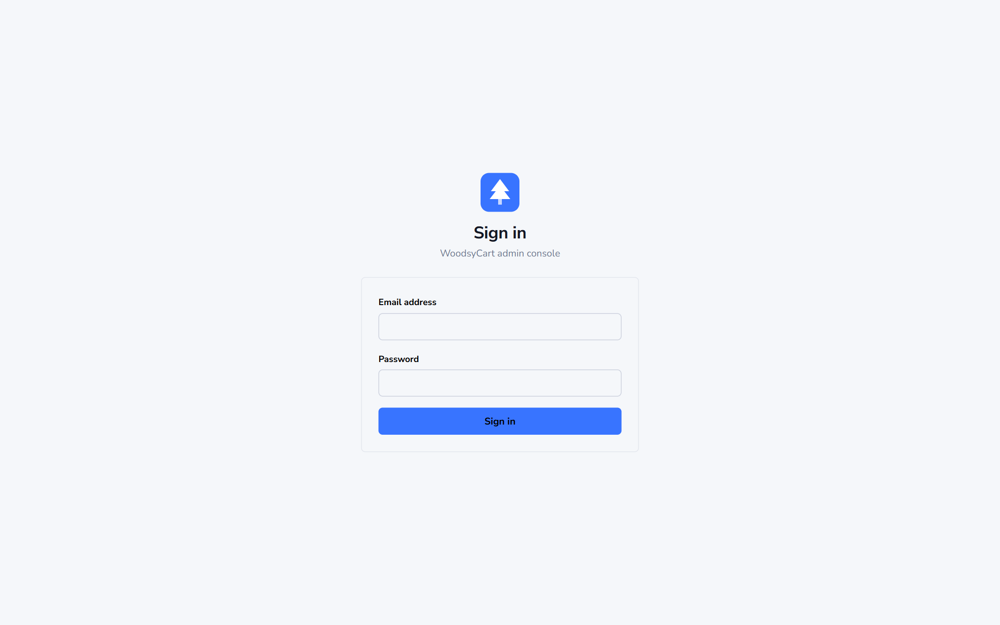

- Only team members added under **Business settings → Team** can sign in. Customer accounts can't.
- You stay signed in for **12 hours**. After that you're asked to sign in again; nothing you saved is lost.
- Forgot your password? Ask another Admin to reset it in **Business settings → Team** (see [25.5](#255-team-tab)).

### 1.2 The screen layout

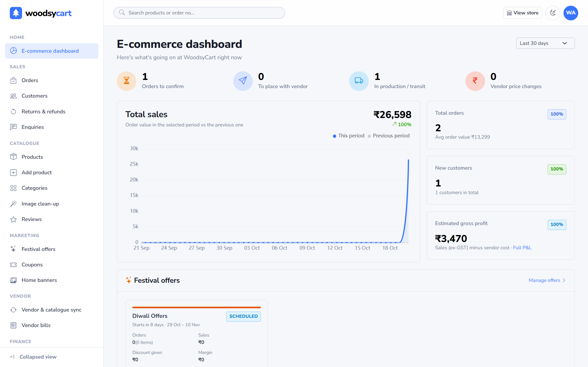

| Area | What it does |
|---|---|
| **Left menu** | All screens, grouped into Home, Sales, Catalogue, Marketing, Vendor, Finance and Settings. The screen you're on is highlighted. |
| **Collapsed view** (bottom of the menu) | Shrinks the menu to icons only, to give tables more room. Click again to expand. |
| **Search box** (top bar) | Type an order number (e.g. `WC2610200002`) and press Enter to search Orders; any other text searches Products. |
| **View store** | Opens the customer website in a new tab. |
| **Moon / sun icon** | Switches between light and dark mode. Your choice is remembered on this computer. |
| **Round initials button** | Your name and email, a shortcut to **Settings**, and **Sign out**. |

On a phone, the menu is hidden behind the **☰** button at the top left.

### 1.3 Roles: Admin and Staff

There are two roles: **Admin** and **Staff**. At the moment **both roles can open and change every screen**. Give accounts only to people you trust, and switch an account off (**Active** off) as soon as someone leaves.

---

## 2. How WoodsyCart works — the big picture

WoodsyCart is a **drop-shipping** store. You don't keep stock. You sell the vendor's (GB Furniture's) products at your own price, and the vendor makes and delivers them to your customer.

### 2.1 The life of an order

```
 Customer orders on woodsycart.in  ─►  Pays (UPI / card / …)
          │
          ▼
 1. PENDING ── you check the order and payment ──► 2. CONFIRMED
          │
          ▼
 3. PLACED WITH VENDOR ── you send it to the vendor on WhatsApp
          │                (a Purchase Order "PO" is created automatically)
          ▼
 4. DISPATCHED ── the vendor has sent it (add tracking if any)
          │
          ▼
 5. OUT FOR DELIVERY (optional)  ─►  6. DELIVERED
          │                              │
          │                              ├─ customer invoice is created automatically
          │                              └─ revenue now counts in Profit & loss
          ▼
 Cancelled (before dispatch) · Returned (after delivery, via a refund)
```

### 2.2 How money flows

| Money | Where you record it | Where it shows |
|---|---|---|
| Customer pays you | Automatically (UPI alert, gateway) or **Record payment** on the order | Order **Summary**, P&L **Cash position** |
| You owe the vendor | **Vendor bill** (from the vendor's invoice) | Vendor bills, P&L **Cost of goods**, **Payable** |
| You pay the vendor | **Pay** on the vendor bill | Vendor bills **Paid**, P&L **Paid to vendors** |
| Your running costs (ads, hosting…) | **Expenses** | P&L **Operating expenses** |
| Money returned to a customer | **Returns & refunds** | Order, P&L **Less: refunds** |

### 2.3 Where the products come from

The **vendor sync** (chapter 18) copies the vendor's catalogue from their online store: products, options (size, colour…), variants, prices, stock and photos. Your **commission** is added on top to get your selling price. The sync runs automatically every day, and you can also run it any time.

---

## 3. Every calculation explained

This chapter explains every number the app calculates. The examples use your current settings: **15% commission**, **18% GST**, **vendor prices are before GST**, rounding **"End with 99"**.

### 3.1 Your cost (what you pay the vendor)

```
Your cost = Vendor price × (1 + GST %)
```

GB Furniture's website prices are **before GST**; they add 18% on their bill. So for a ₹10,000 product:

> ₹10,000 + 18% GST (₹1,800) = **your cost ₹11,800**

If a vendor's prices already include GST, switch on **Vendor prices already include GST** in **Business settings → Pricing**. Then *your cost = vendor price*.

### 3.2 Selling price (what the customer pays)

```
Selling price = Your cost × (1 + Commission %) → then rounded
```

> ₹11,800 × 1.15 = ₹13,570 → rounded "End with 99" → **₹13,599**

**Which commission % is used?** The first one that is set, in this order:

1. The product's own **Commission % (override)** (on the product page or **Set commission** in bulk)
2. The product's **category** commission (Categories screen)
3. The **Default commission %** (Business settings → Pricing)

**Rounding options** (Business settings → Pricing → Price rounding):

| Option | ₹13,570 becomes |
|---|---|
| End with 99 | ₹13,599 (next hundred minus 1) |
| Round up to ₹10 | ₹13,570 |
| Round up to ₹100 | ₹13,600 |
| No rounding | ₹13,570 |

**Products with options (variants):** each variant (e.g. 6×5 ft, 6.5×5 ft) gets its own price the same way. The price shown on product cards is the **cheapest active variant**, with "From" in front of it.

**Manual price:** switch on **Set selling price manually** on a product to type your own price. Manual prices are never recalculated, not even when the vendor's price changes, so check them yourself.

### 3.3 MRP and "% off"

- **MRP** is the vendor's MRP converted the same way (vendor MRP × 1.18), and it's never shown lower than your selling price.
- **% off** on the store = (MRP − price) ÷ MRP × 100. Badges only show from 5% off (3% for the struck-through MRP).

### 3.4 Margin

```
Margin (₹) = Selling price − Your cost
Margin %   = Margin ÷ Selling price × 100
```

> ₹13,599 − ₹11,800 = **₹1,799** → 1,799 ÷ 13,599 = **13.2%**

On the Products list, a margin **below 8%** is shown in red, and **Low margin (<8%)** lists those products.

### 3.5 What happens when the vendor changes a price

During a sync, if the vendor's price changes:

1. The product's **vendor price** is updated, and the old one is kept as **was ₹…**.
2. Your **selling price is recalculated automatically** (unless it's a manual price).
3. The product is flagged **Vendor price changed** so you can review it. The dashboard shows how many.
4. On the Products list, select the reviewed products and press **Accept price change** to clear the flag.

### 3.6 Order totals (cart and checkout)

```
Items subtotal = sum of (price × quantity)            ← GST included in prices
− Coupon discount
+ Delivery fee        (0 if subtotal − coupon ≥ "Free delivery above ₹")
+ Pincode extra charge (from Delivery pincodes)
+ COD fee              (only for cash on delivery)
= Total
```

- **GST included** on an order is the GST *contained* in the total (prices include GST). It's only calculated when you're GST-registered.
- **Coupon %** is applied to the items subtotal, capped by the coupon's **Max discount** and rounded down to whole rupees.
- **Festival offer** savings are already inside the item prices (see 3.9). They're shown separately so you can see what the offer cost you.

### 3.7 The unique UPI amount (Direct UPI)

For Direct UPI orders the customer is asked to pay a slightly **smaller, unique amount**, e.g. **₹13,298.73** instead of ₹13,299. The few paise difference is a "fingerprint": when your bank's "credited ₹13,298.73" SMS arrives, the app knows exactly which order it belongs to and confirms it automatically. Differences of under ₹1 still count as fully paid.

### 3.8 Profit on an order (estimated vs actual)

Shown on each order (**Profit** card) and in Profit & loss:

```
Revenue (ex-GST) = Order total − GST included
Vendor cost      = vendor bill amount, if a bill is linked to the order (ACTUAL)
                   otherwise vendor price × quantity at order time (ESTIMATED)
Gross profit     = Revenue (ex-GST) − Vendor cost
```

- **Estimated** (yellow badge): no vendor bill yet; cost comes from the vendor's listed price.
- **Actual** (green badge): a vendor bill is linked; cost comes from the bill.
- When you're **not GST-registered**, the GST you pay the vendor can't be claimed back, so cost **includes** GST.
- When you're **GST-registered**, that GST is claimed back as input credit, so cost is **before** GST.

**Est. margin** on the Orders list is simpler: *order total − estimated vendor cost (incl. GST)*.

### 3.9 Festival offer price

```
Offer price = Regular price − discount (rounded down to whole ₹)
              but never below: Your cost × (1 + Minimum margin %)
```

> Regular ₹13,299, offer 10% off → ₹11,969. Cost ₹11,564 × 1.05 = ₹12,143 floor → offer price **₹12,143** (8.7% off).

If two offers cover the same product, the customer gets the **lower** price.

### 3.10 Dashboard figures

| Figure | Calculation |
|---|---|
| **Total sales** | Sum of order totals (not cancelled) placed in the selected period |
| **% change** | Compared with the previous period of the same length (e.g. the 30 days before) |
| **Total orders** | Orders placed in the period (not cancelled) |
| **Avg order value** | Total sales ÷ Total orders |
| **New customers** | Customer accounts (including guests) created in the period |
| **Estimated gross profit** | (Item sales − coupons − GST) − vendor cost of those orders |

### 3.11 Profit & loss figures

See chapter 20 for every line. In short:

```
Gross sales (delivered orders, incl. GST)
− GST collected (if GST-registered)
− Refunds processed
= Net revenue
− Cost of goods (vendor bills, or estimates)
= Gross profit
− Operating expenses
= NET PROFIT
```

---

## 4. Dashboard

*Menu: Home → E-commerce dashboard.* The first screen after signing in: a quick health check of the business.


**Period selector** (top right): **Last 7 days / 30 days / 90 days / 12 months**. Every figure on the page follows it, except **Needs your attention**, which always shows what is open right now.

### 4.1 Action strip (top row)

Four big tiles that take you straight to work:

| Tile | Counts | Clicking opens |
|---|---|---|
| **Orders to confirm** | Orders in **Pending** | Orders → Pending |
| **To place with vendor** | Orders in **Confirmed** (paid/approved, not yet sent to the vendor) | Orders → Confirmed |
| **In production / transit** | Orders **With vendor**, **Dispatched** or **Out for delivery** | Orders in transit |
| **Vendor price changes** | Products whose vendor price changed and you haven't accepted yet | Products → Vendor price changed |

### 4.2 Total sales chart

The solid line is this period's daily sales. The dashed grey line is the previous period, so you can compare. The % next to the total is the change between them.

### 4.3 KPI cards

**Total orders**, **New customers** and **Estimated gross profit**, each with the % change from the previous period. See [3.10](#310-dashboard-figures) for how each is calculated. **Full P&L** opens Profit & loss.

### 4.4 Festival offers

Running, upcoming and recently ended (last 30 days) offers. Each one shows its status, timing ("Ends in 3 days"), **Orders**, **Sales**, **Discount given** and **Margin**. **Manage offers** opens Marketing → Festival offers.

### 4.5 Charts

| Card | Shows |
|---|---|
| **Sales by category** | Which furniture categories earn the most (₹) in the period |
| **Payment methods** | How customers pay (UPI, card, COD…) |
| **Order status** | How many orders are at each stage |

### 4.6 Latest orders

The 8 most recent orders. Click one to open it.

### 4.7 Needs your attention

Open jobs. Click any line to see the list:

| Line | Meaning | What to do |
|---|---|---|
| **Unpaid vendor bills** | Vendor bills not fully paid, and the total owed | Pay the vendor, then record it (chapter 19) |
| **Delivered without invoice** | Delivered orders with no customer invoice | Open the order → **Generate invoice** |
| **Payment to collect** | Delivered orders where the customer hasn't paid in full (usually COD) | Collect, then **Record payment** |
| **Returns & refunds open** | Refund requests not finished | Chapter 8 |
| **Out of stock at vendor** | Published products the vendor marked unavailable | Unpublish them or wait for stock |
| **New enquiries** | Contact-form messages not yet handled | Chapter 9 |
| **Reviews to moderate** | Customer reviews waiting for approval | Chapter 14 |

### 4.8 Top products and Top areas

The best-selling products (by ₹ and units), and the pincodes/areas ordering the most. Useful for deciding where to advertise.

---

## 5. Sales → Orders

*Menu: Sales → Orders.* Every order placed on the store.

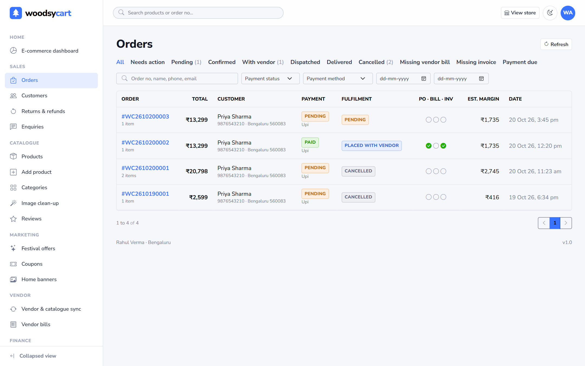

### 5.1 The tabs: when does an order appear in each?

| Tab | An order appears here when… | It leaves when… |
|---|---|---|
| **All** | Always: every order | Never |
| **Needs action** | It's **Pending** or **Confirmed**, i.e. you must do something | You mark it placed with vendor (or cancel it) |
| **Pending** | The customer just placed it (or is still paying) | You mark it **Confirmed** or it's paid automatically |
| **Confirmed** | Payment received / you confirmed it | You mark it **Placed with vendor** |
| **With vendor** | You sent it to the vendor | You mark it **Dispatched** |
| **Dispatched** | The vendor shipped it | You mark it **Delivered** / **Out for delivery** |
| **Delivered** | Delivered to the customer | Only if it's later returned |
| **Cancelled** | Cancelled by you or the customer | Never |
| **Missing vendor bill** | It's with the vendor, dispatched or delivered, but no vendor bill is linked | You add the vendor bill |
| **Missing invoice** | It's delivered but has no customer invoice | You generate the invoice |
| **Payment due** | It's delivered but not fully paid (usually COD) | You record the payment |

The number in brackets after a tab is how many orders are in that status.

> **Tip:** Work through **Needs action** every morning, and **Missing vendor bill** / **Missing invoice** once a week. When all three are empty, your books are complete.

### 5.2 Filters

- **Search:** order number, customer name, phone or email.
- **Payment status:** Pending, Partially paid, Paid, Failed, Refunded.
- **Payment method:** UPI, Card, Net banking, Wallet, EMI, Bank transfer, Cash on delivery, or "Online (older orders)".
- **From / To dates:** when the order was placed.
- **Refresh:** reloads the list. New orders don't appear by themselves.

### 5.3 Columns

| Column | Meaning |
|---|---|
| **Order** | Order number (e.g. `WC2610200002` = WoodsyCart, 2026-10-20, order no. 2 that day) and item count |
| **Total** | What the customer pays, all charges included |
| **Customer** | Delivery name, phone, city and pincode |
| **Payment** | Payment status (coloured) and method |
| **Fulfilment** | Order status |
| **PO · Bill · Inv** | Three circles: ✔ green = done, ○ grey = missing. **PO** = purchase order to vendor, **Bill** = vendor's bill entered, **Inv** = customer invoice created |
| **Est. margin** | Order total − estimated vendor cost (incl. GST). Red if negative |
| **Date** | When it was placed |

Click any row to open the order.

---

## 6. Sales → Order details (one order)

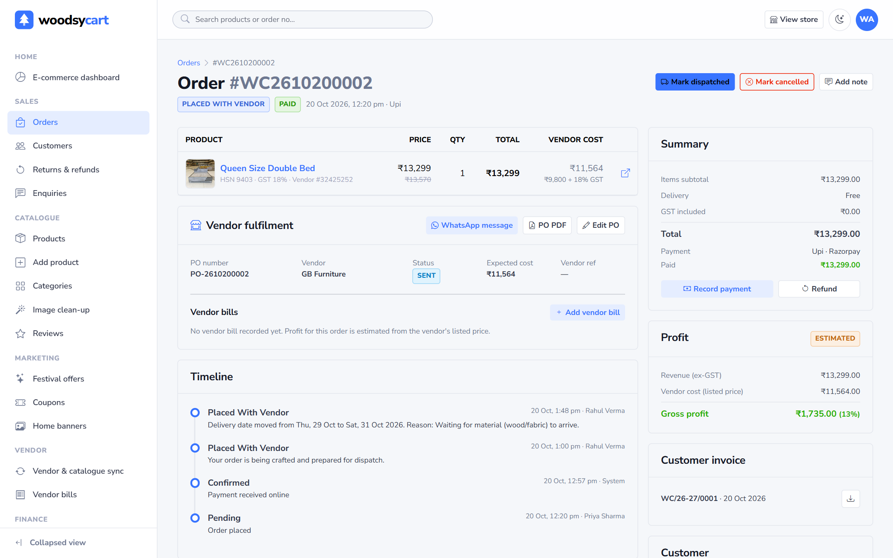

### 6.1 Header

- **Order #…** with its **status** and **payment status** badges, the date and the payment method.
- **Action buttons:** only the next sensible steps are offered:

| Current status | Buttons shown |
|---|---|
| Pending | **Mark confirmed**, **Mark cancelled** |
| Confirmed | **Mark placed with vendor**, **Mark cancelled** |
| Placed with vendor | **Mark dispatched**, **Mark cancelled** |
| Dispatched | **Mark out for delivery**, **Mark delivered** |
| Out for delivery | **Mark delivered** |
| Delivered | **Mark returned** |

- **Add note:** adds a message to the timeline. Tick **Visible to customer** to show it on their order page; otherwise it's internal.

### 6.2 Updating the status (the status window)

Clicking a status button opens a small window:

- **Message:** what the customer sees on their order timeline and in the email. Leave it empty for a sensible default, e.g. *"Your order has been dispatched."*
- **Visible to customer:** ticked = the customer sees it and gets an email. Untick for internal steps.
- **Dispatched only:** **Courier / transporter**, **Tracking / LR no.** and **Expected delivery** date.
- **Delivered only:** **Balance … was collected on delivery** appears when money is still due; tick it to record the cash payment.
- **Cancelled:** the message becomes the **cancellation reason**. If the customer had paid, a refund is created automatically (see chapter 8).

What happens automatically:

| You mark… | The app also… |
|---|---|
| **Placed with vendor** | Creates the **Purchase Order** (PO-…) if there isn't one |
| **Dispatched** | Sets the PO to Dispatched |
| **Delivered** | Records the delivery time, adds the sale to "units sold", sets the PO to Delivered, **creates the customer invoice**, and the revenue starts counting in Profit & loss |
| **Cancelled** | Gives the coupon use back, creates a refund if money was paid, and emails the customer |

### 6.3 Items

Each product with its option (e.g. "6x5ft Marble"), HSN code, GST %, vendor item number, **Price** (with MRP struck through), **Qty**, **Total**, and **Vendor cost**: what you pay the vendor for that line, *including GST* (the line below shows "vendor price + GST"). The ↗ icon opens the product on the vendor's website.

### 6.4 Vendor fulfilment

Everything about getting the order made by the vendor.

- **WhatsApp message:** builds a ready-to-send message for the vendor: items (using the *vendor's* own names for sizes and colours), your price to them, links, and the customer's delivery address. **Open WhatsApp** opens the vendor's chat with it filled in; **Copy** copies it.
- **PO PDF:** a printable Purchase Order to send the vendor.
- **Create PO / Edit PO:** the purchase order details:
  - **Vendor**, **Status** (Draft, Sent, Accepted, Dispatched, Delivered, Cancelled)
  - **Agreed cost (₹):** what the vendor will charge for this order
  - **Vendor order ref:** the vendor's own order number
  - **Expected dispatch:** when the vendor said they'd send it
  - **Notes for vendor**
- **Vendor bills:** bills from the vendor for this order. **Add vendor bill** opens the bill form, already filled in with the expected amounts:
  - **Taxable value** = vendor prices × quantities; **GST**; **Delivery charges**; **Bill total** = the three added up
  - **Attach bill (PDF / photo):** keep a copy of the vendor's invoice
  - Once a bill is linked, the order's profit becomes **Actual** (see [3.8](#38-profit-on-an-order-estimated-vs-actual)).

### 6.5 Timeline

Every step in order, with time, who did it, and the message. Entries marked **Internal** are only visible to your team. Customers see the others on their order page.

### 6.6 Summary (right side)

| Line | Meaning |
|---|---|
| **Items subtotal** | Sum of item totals (GST included) |
| **Discount (CODE)** | Coupon discount |
| **Delivery** | Delivery fee, or Free |
| **COD fee** | Extra charge for cash on delivery |
| **GST included** | GST contained in the total (0 if not GST-registered) |
| **Total** | What the customer pays |
| **Payment** | Method · provider (e.g. UPI · Direct UPI) |
| **UPI amount to receive** | The unique amount the customer was asked to pay (see [3.7](#37-the-unique-upi-amount-direct-upi)) |
| **Customer's UTR** | The UPI reference the customer typed after paying |
| **Paid** | Money received so far |
| **Balance due** | Total − Paid (shown in red when money is still due) |

- **Record payment:** when money arrives outside the automatic flow (cash, bank transfer, a UPI the system missed). Choose the method, amount, date and **Reference / UTR**. The payment status becomes **Paid** when the full total is received, or **Partially paid** otherwise.
- **Refund:** appears once money has been received; creates a refund (chapter 8).

### 6.7 Profit

**Revenue (ex-GST)**, **Vendor cost** (bill or listed price), **Gross profit** and margin %, with an **Actual / Estimated** badge. See [3.8](#38-profit-on-an-order-estimated-vs-actual).

### 6.8 Customer invoice

The invoice is created automatically when you mark the order **Delivered**. **Generate invoice** creates it earlier if a customer needs it before delivery. **⬇** downloads the PDF. Invoices are cancelled from Finance → Customer invoices.

### 6.9 Customer card and Delivery date

- The customer's name (click for their profile), email, phone, delivery address, GSTIN if given, tracking details and the customer's own **note**.
- **Delivery date** shows the expected date, and **Change** / **Set** updates it:
  - Pick the **New expected date** (not in the past).
  - Choose a quick **reason** (vendor needs more time, transport delay, festival/holiday, heavy rain, waiting for material) or write your own. A reason is **required** when the date moves later.
  - **Email the customer** (on by default) sends them an apology email with the old and new dates and the reason.
  - The customer's order and tracking page shows *"New expected delivery … originally expected on …"* with the reason.
  - After a change, the card shows **Originally promised …** and **Reason given …**.

### 6.10 Internal notes

Free-text notes only your team sees (for example "customer prefers delivery after 6 pm"). Press **Save notes**.

> **Watch out:** furniture is made to order. If you cancel after placing the order with the vendor, the vendor may still charge you. Confirm with the vendor first.

---

## 7. Sales → Customers

*Menu: Sales → Customers.*

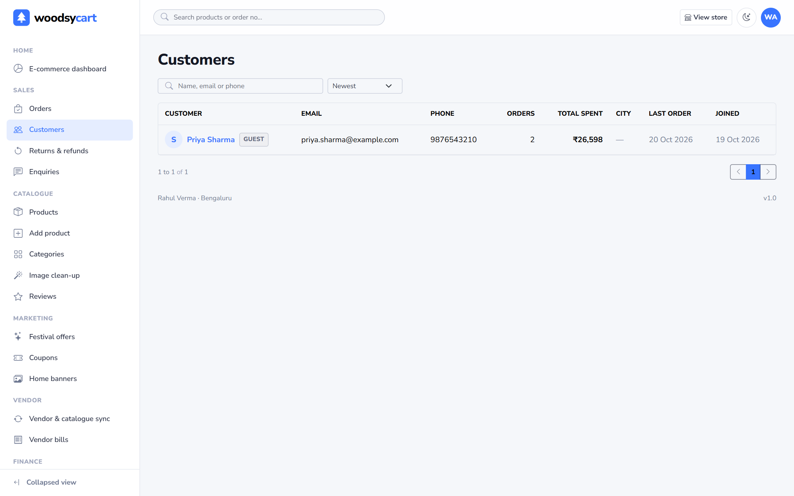

**List:** search by name, email or phone; sort by **Newest**, **Top spenders**, **Most orders** or **Recent buyers**. Columns: **Orders**, **Total spent** (non-cancelled orders), **City**, **Last order**, **Joined**.

- **Guest** badge: the person bought without creating an account (guest checkout). If they later register with the same email, their old orders join their account.
- **Blocked** badge: the customer can't sign in or order.

**Customer details:**

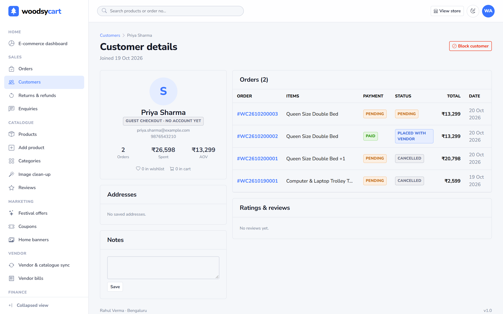

- **Orders / Spent / AOV** (average order value = spent ÷ orders), items in their **wishlist** and **cart**.
- **Addresses** they saved, **Notes** (internal), their **Orders** list and **Ratings & reviews**.
- **Block customer / Unblock customer:** use for fraud or abuse only.

---

## 8. Sales → Returns & refunds

*Menu: Sales → Returns & refunds.*

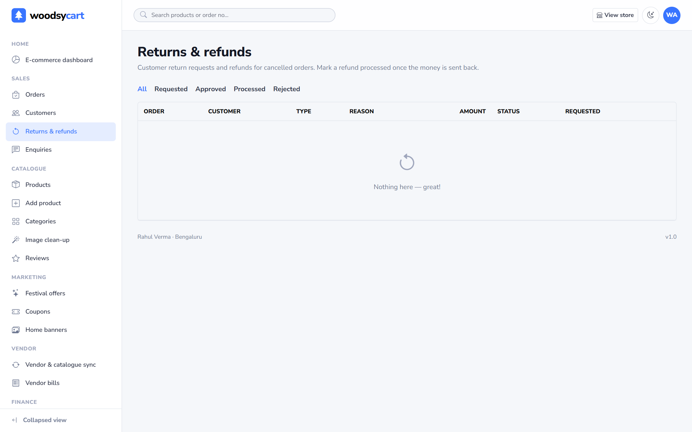

### 8.1 When does a refund appear here?

| Type | Created when… | Starts as |
|---|---|---|
| **Cancellation** | A paid order is cancelled (by you or the customer) | Approved |
| **Return** | The customer asks to return a delivered order (within **7 days** of delivery) | Requested |
| **Partial** | You press **Refund** on an order (e.g. a small damage compensation) | Approved |

### 8.2 Tabs and statuses

**All / Requested / Approved / Processed / Rejected.**

- **Requested:** the customer asked; you must decide.
- **Approved:** agreed, but the money hasn't been sent yet.
- **Processed:** the money has been sent back. Final.
- **Rejected:** declined. Final.

### 8.3 Processing a refund

Press **Update** → set **Status** and **Amount**, enter the **Refund reference / UTR** of your bank or UPI transfer, add **Notes** → **Save**.

When you set **Processed**:

- The order's payment status becomes **Refunded** (full) or **Partially refunded**.
- For a **Return**, the order status becomes **Returned**.
- A timeline entry is added and the customer is emailed.
- The amount appears under **Less: refunds** in Profit & loss.

> **Tip:** for card / net-banking orders paid through a gateway, issue the refund from the gateway's dashboard first, then paste its refund id here.

---

## 9. Sales → Enquiries

*Menu: Sales → Enquiries.* Messages from the store's **Contact** page and the **Ask about this product** button. Custom sizes and bulk orders usually come in here.

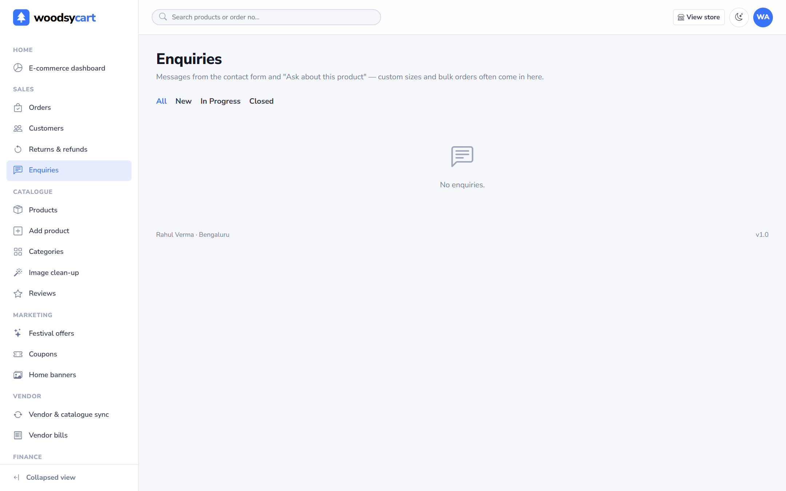

- Tabs: **All / New / In progress / Closed**.
- Each card shows the name, phone, email, product (if asked from a product page), the message and the time.
- Type **Notes**, change the status, then **Save**. The green WhatsApp button opens a chat with the customer.

---

## 10. Catalogue → Products

*Menu: Catalogue → Products.*

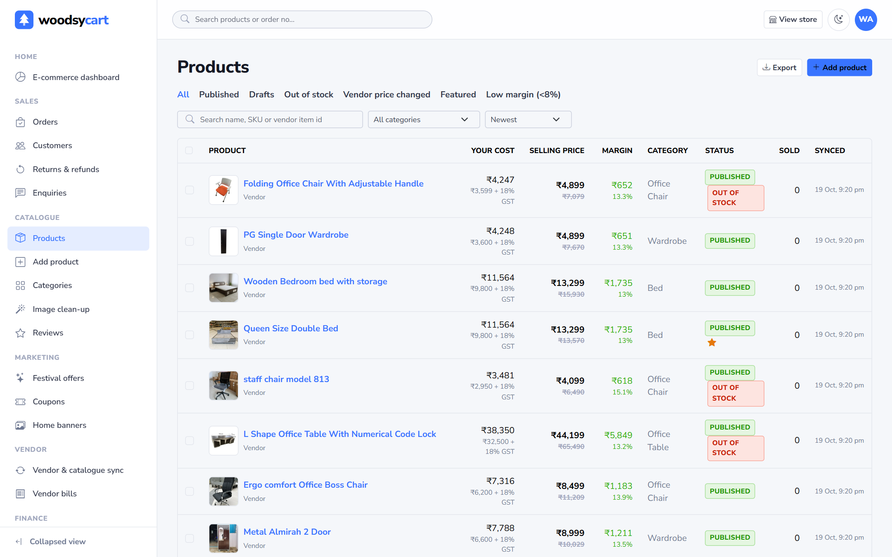

### 10.1 Tabs

| Tab | Shows |
|---|---|
| **All** | Every product (except deleted ones) |
| **Published** | Visible on the store |
| **Drafts** | Hidden from the store (new vendor products when "Publish new products" is off, products only sold in other cities, or ones you unpublished) |
| **Out of stock** | The vendor marked them unavailable |
| **Vendor price changed** | The vendor's price changed and you haven't accepted it yet (see [3.5](#35-what-happens-when-the-vendor-changes-a-price)) |
| **Featured** | Marked ★ featured (shown in "Best sellers" on the home page) |
| **Low margin (<8%)** | Margin below 8% of the selling price |

### 10.2 Search, filter and sort

Search by **name, SKU or vendor item id**; filter by category; sort by **Newest, Name, Price ↑, Price ↓, Lowest margin, Best selling**.

### 10.3 Columns

| Column | Meaning |
|---|---|
| **Product** | Name, number of variants, **Vendor** or **Manual** source, and the commission override if set |
| **Your cost** | Vendor price + GST (the small line shows the split); **was ₹…** in red when the vendor's price changed |
| **Selling price** | Your price (MRP struck through) |
| **Margin** | ₹ and %: green from 8%, red below |
| **Category** | The product's category |
| **Status** | **Published** / **Draft**, **Out of stock**, ★ featured |
| **Sold** | Units delivered so far |
| **Synced** | Last time the vendor sync updated it |

### 10.4 Bulk actions

Tick products (or the box in the header for the whole page) and a toolbar appears:

- **Publish / Unpublish / Feature**
- **Accept price change:** clears the "vendor price changed" flag
- **Set commission:** a commission % for the selected products (empty = use the category/default); prices are recalculated
- **Set GST %:** 0, 5, 12, 18 or 28%; costs and prices are recalculated
- **Delete:** removes them from the store and lists (order history is kept)

**Export** downloads all products as a spreadsheet (CSV) with costs, prices and margins.

---

## 11. Catalogue → Add / edit a product

*Click a product, or **Add product**.*

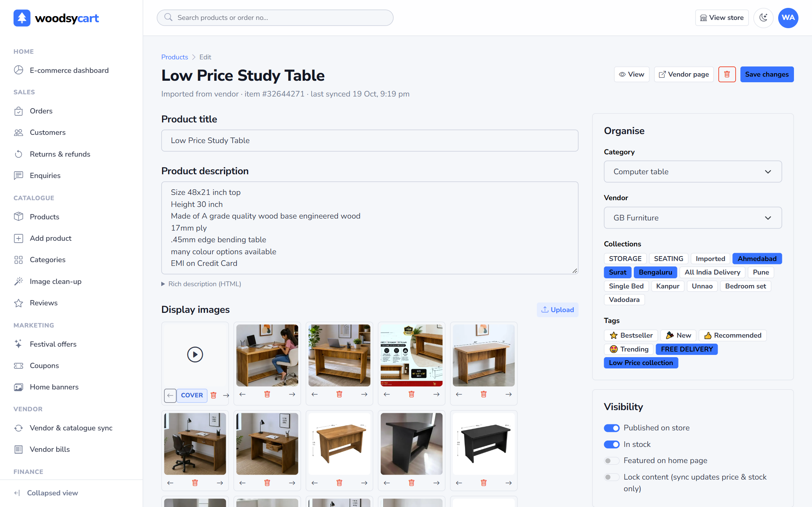

### 11.1 Top of the page

- For vendor products, the subtitle shows *"Imported from vendor · item #… · last synced …"*.
- **View** opens it on the store; **Vendor page** opens it on the vendor's website; 🗑 deletes it.
- **Save changes** (or **Publish product** for a new one).
- A yellow banner appears when **the vendor changed the price**, showing the old and new price.

### 11.2 Title, description and images

- **Product title** and **Product description** (one highlight per line; they're shown as bullet points). **Rich description (HTML)** is optional formatted text.
- **Display images:** **Upload** photos or MP4 videos. The first image is the **Cover**. Use ← → to reorder, 🗑 to delete. **Variant** marks photos that belong to one option (e.g. one colour).
- Uploaded and synced photos are automatically cleaned of vendor names (chapter 13).

### 11.3 Pricing tab

| Field | Meaning |
|---|---|
| **Vendor MRP (₹)** | The vendor's MRP (used for the struck-through price) |
| **Vendor price (₹)** | The vendor's selling price to you (before GST for GB Furniture) |
| **GST %** | The product's GST rate |
| *Cost line* | "Vendor price + 18% GST = **your cost**" |
| **Commission % (override)** | Leave empty to use the category/default; "Currently applied: X%" shows what's used |
| **Set selling price manually** | Turn on to type **MRP shown** and **Selling price** yourself |
| *Price preview* | **Selling price**, **MRP shown**, **Your margin** |
| **Variants** table | Each option combination: vendor price, price, **In stock**, **Active**. Vendor variant names can't be edited here; use the **Options & colours** tab |

### 11.4 Options & colours tab

Lets you change the options customers choose from (Size, Colour…). See the full explanation in [11.8](#118-options--colours-in-detail).

### 11.5 Furniture details tab

**Material**, **Dimensions**, **Warranty**, **Delivery (days)**, **Free assembly**, **SKU**, **HSN code** (for invoices; furniture is usually 9403), **Brand shown**. These appear on the product page and invoices.

### 11.6 SEO tab

**URL slug** (the web address, e.g. `/product/queen-size-double-bed`), **Meta title** and **Meta description** (what Google shows). Leave them empty to use the product name.

### 11.7 Right side

- **Organise:** **Category**, **Vendor**, **Collections**, **Tags** (e.g. "⭐ Bestseller").
- **Visibility:**
  - **Published on store:** visible to customers.
  - **In stock:** can be ordered.
  - **Featured on home page.**
  - **Lock content** (vendor products): the sync only updates price and stock, never your title, description or photos. Turn it on once you've rewritten a product.
- **Performance:** units sold and rating.

### 11.8 Options & colours in detail


Colours and names start **exactly as the vendor sends them**. Everything you change here is **kept when the vendor syncs**, and new colours the vendor adds still appear automatically.

- **Option name:** rename it (e.g. the vendor's "Name of Colour" → "Colour"). The note *"From the vendor as …"* shows the original name.
- **Colour swatches:** shows the values as coloured circles on the store and includes them in the colour filter.
- **Each value:**
  - Click the circle (or type a #code) to set its colour, and edit its name.
  - **Vendor: Junglewood ● #574211** shows the vendor's original; **use vendor's** puts it back.
  - **N variants** = how many sellable combinations use this value.
  - ▲▼ change the order customers see.
- **Remove (×):**
  - A colour **you added** is deleted.
  - A **vendor** colour is **hidden** instead, so the next sync doesn't bring it back. **Restore** shows it again.
  - Removing a value switches off its variants.
- **Add a value:** type the name, pick the colour, choose **Price like …** (an existing value to copy prices from), then **Add**. The new colour's prices keep following that vendor colour's price automatically.
- **Add option:** e.g. add Colour to a product that has none. Every current variant gets the first value; each further value becomes a copy with the same prices.
- **Save options** saves; **Discard** cancels.

> **Watch out:** for a colour you added yourself, tell the vendor exactly what to make. The WhatsApp message and PO already say *"… — but Colour: Walnut"*.

---

## 12. Catalogue → Categories & collections

*Menu: Catalogue → Categories.*

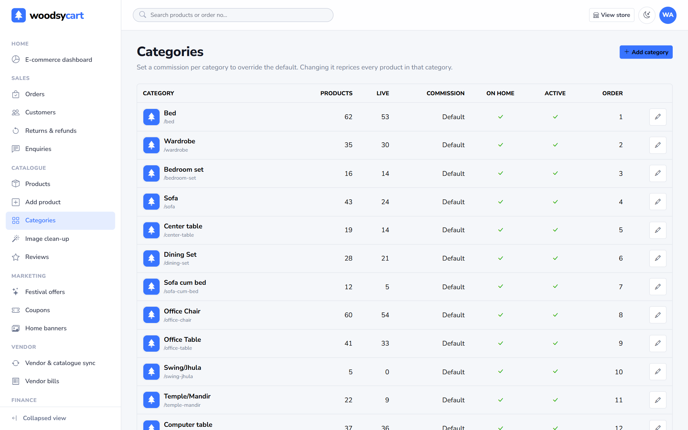

**Categories table:** **Products** (total), **Live** (published), **Commission** (or Default), **On home** (shown on the home page), **Active**, **Order** (position).

**Add / edit category:** **Name**, **Sort order**, **URL slug**, **Commission % override** (reprices all its products when saved), **Description**, **Image** (otherwise the cover of its best product is used), **Active**, **Show on home page**. A category with no products can be deleted.

**Collections** (below): groups imported from the vendor, many of which are vendor city branches (Ahmedabad, Surat, Bengaluru…). Switch **Visible** off for the ones customers shouldn't filter by.

---

## 13. Catalogue → Image clean-up

*Menu: Catalogue → Image clean-up.* Removes the vendor's name, website, phone numbers and prices printed on product photos, and keeps dimensions and model codes.

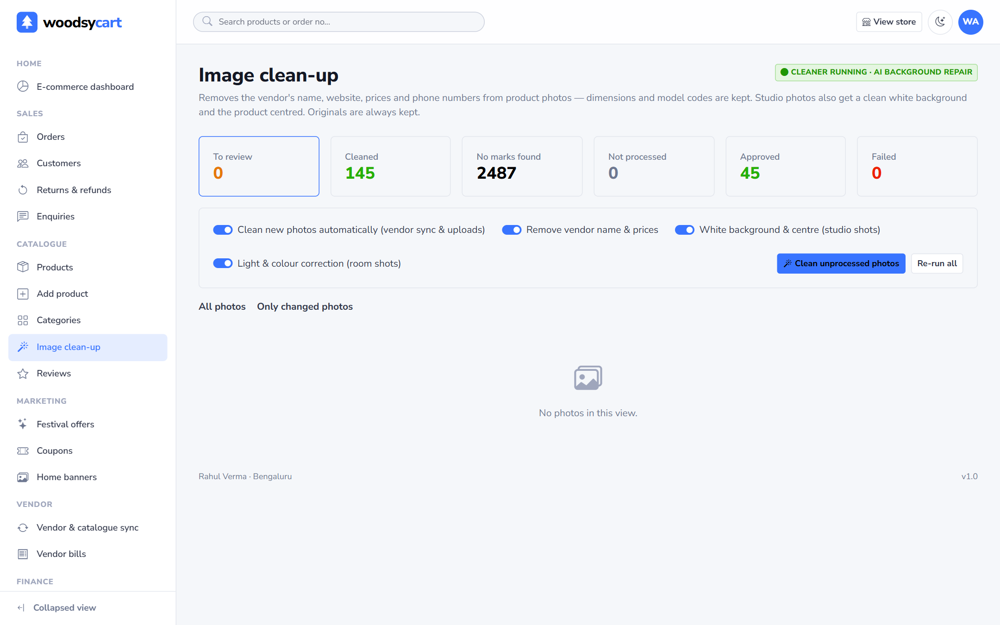

- **Status cards:** whether the cleaner is **Online** (and with which repair engine: **LaMa** = AI repair, best quality), how many photos are **queued**, and counts per result.
- **Settings switches:**
  - **Clean new photos automatically (vendor sync & uploads).**
  - **Remove vendor name & prices.**
  - **White background & centre (studio shots):** also crops the blurred side strips.
  - **Light & colour correction (room shots).**
- **Buttons:** **Clean unprocessed photos**; **Re-run all** (after changing rules).
- **Results:**
  - **Clean:** nothing to remove.
  - **Cleaned:** text was removed.
  - **To review:** the tool wasn't sure (e.g. a bare number like "34500").
  - **Failed:** something went wrong.
  - **Restored:** you chose the original.
  - **Approved:** you confirmed the result.
- **Before / after grid:** the original and the cleaned photo side by side, with the text found shown as chips (red = removed, green = kept, yellow = review). **Looks good** approves; **Use original** switches back; **Re-run** cleans it again.

The original photo is always kept, so nothing is lost.

---

## 14. Catalogue → Reviews

*Menu: Catalogue → Reviews.* Tabs **Pending / Approved / All**.

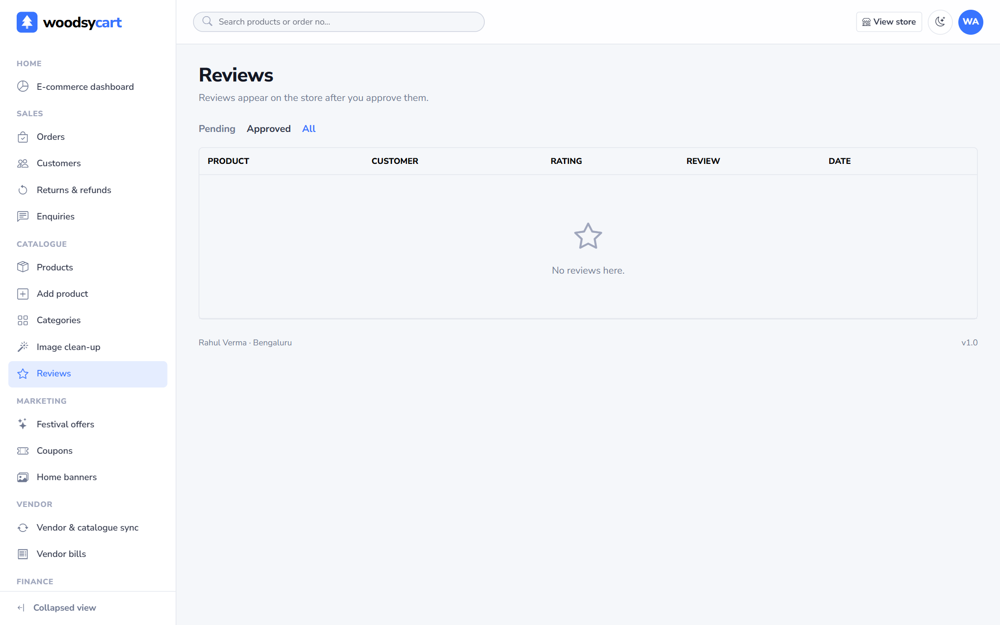

Reviews appear on the store only after you **Approve** them. **Verified buyer** = the customer had a delivered order for this product. **Hide** takes an approved review down; 🗑 deletes it. A product's star rating counts approved reviews only.

---

## 15. Marketing → Festival offers

*Menu: Marketing → Festival offers.* Time-limited sales such as Diwali or Onam that **start and end by themselves**.

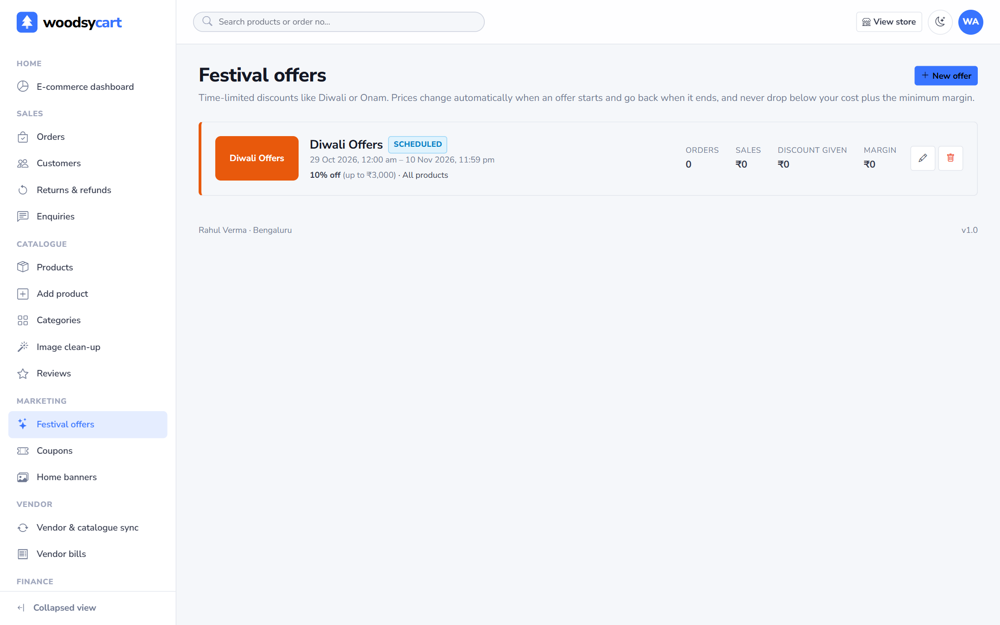

### 15.1 The offers list

Each offer card shows its banner (or colour), **status** (**Live now**, **Scheduled**, **Ended**, **Off**), dates, discount, what it applies to, **products on offer** (when live), and its results: **Orders**, **Sales**, **Discount given** and **Margin**. Buttons: ↗ view on the store (when live), ✏ edit, 🗑 delete (only when it has no orders; otherwise switch it off).

### 15.2 Creating an offer

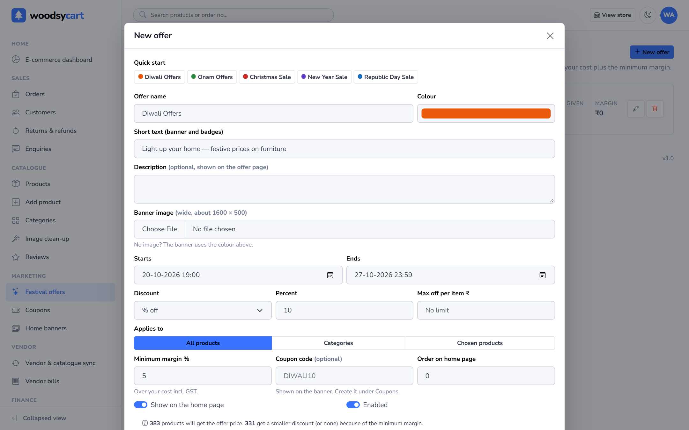

1. **Quick start:** Diwali, Onam, Christmas, New Year or Republic Day fill in a name, text and colour.
2. **Offer name**, **Colour** (used for the banner and badges), **Short text**, optional **Description**.
3. **Banner image** (wide, about 1600 × 500). Without one, the banner uses the colour.
4. **Starts / Ends:** date and time. The offer switches on and off by itself (within about 30 seconds).
5. **Discount:** **% off** (with optional **Max off per item ₹**) or **₹ off each item**.
6. **Applies to:** **All products**, **Categories** (tick them) or **Chosen products** (search and add).
7. **Minimum margin %** (default 5%): the offer price never goes below your cost + this margin ([3.9](#39-festival-offer-price)).
8. **Coupon code** (optional): shown on the banner. Create the coupon itself under Coupons.
9. **Order on home page**, **Show on the home page**, **Enabled**.
10. The blue line shows **how many products will get the offer price**, and how many get a smaller discount because of the minimum margin.

### 15.3 What customers see while it's live

A festive banner with a countdown at the top of the home page, a row of offer products, a highlighted link in the menu, the offer page `/offers/<name>`, badges on product photos, *"you save ₹…"* on product pages, and *"<Offer> price"* in the cart.

> **Watch out:** coupons still work on top of offer prices, and the minimum margin protects only the offer price. Don't combine a big coupon with a big offer.

---

## 16. Marketing → Coupons

*Menu: Marketing → Coupons.*

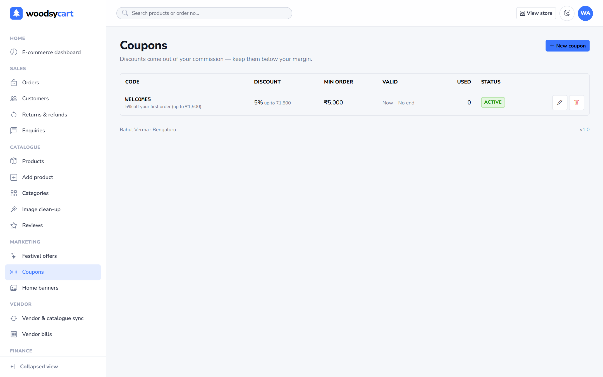

**Columns:** **Code**, **Discount** (% or ₹, "up to" max), **Min order**, **Valid** (dates), **Used** (times used / limit), **Status**.

**New coupon:**

| Field | Meaning |
|---|---|
| **Code** | What customers type, e.g. DIWALI10 (stored in capitals) |
| **Type** | Percent or Flat ₹ |
| **Description** | Shown to customers |
| **Value** | 10 = 10% (or ₹10 for flat) |
| **Max discount ₹** | Cap for percent coupons |
| **Min order ₹** | Cart must be at least this |
| **Starts / Ends** | Valid dates (empty = no limit) |
| **Total uses** | How many times it can be used in total (empty = unlimited) |
| **Uses per customer** | Per signed-in customer |
| **Active** | Switch off to stop it immediately |

The discount comes out of **your** margin. A use is given back if the order is cancelled.

---

## 17. Marketing → Home banners

*Menu: Marketing → Home banners.* The big sliding pictures at the top of the store's home page.

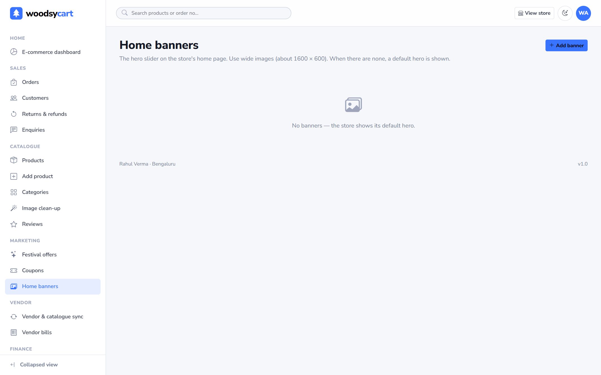

**Add banner:** **Image** (wide, about 1600 × 600), **Title**, **Subtitle**, **Link** (e.g. `/shop?category=sofa` or `/offers/diwali-offers`), **Button text**, **Sort order**, **Active**. When there are no banners, the store shows its built-in welcome section instead. Banners have no dates, so switch them off yourself when a campaign ends.

---

## 18. Vendor → Vendor & catalogue sync

*Menu: Vendor → Vendor & catalogue sync.*

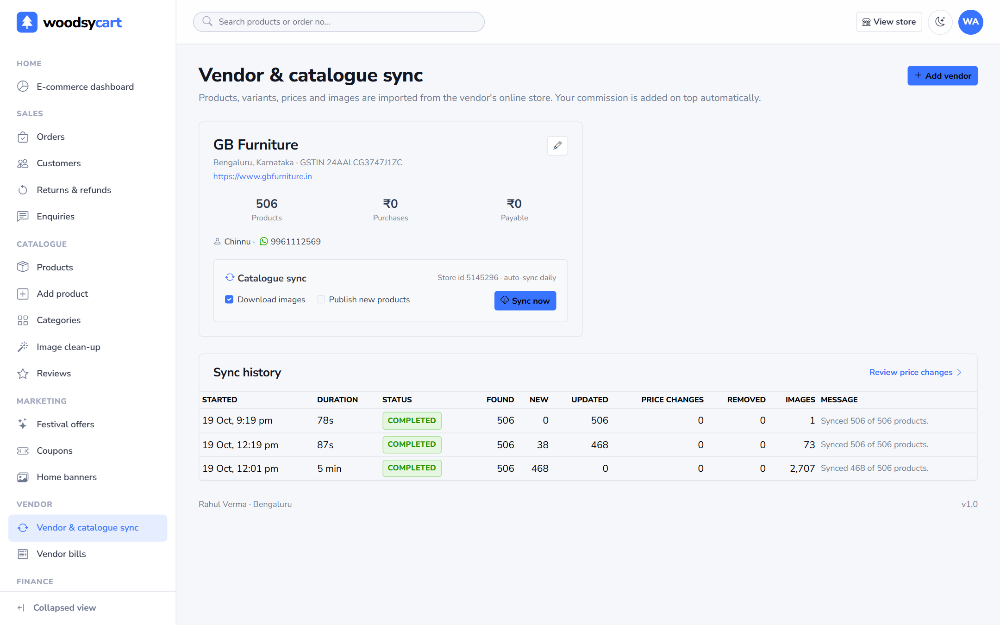

### 18.1 Vendor card

**Name**, city, **GSTIN**, website; **Products**, **Purchases** (total vendor bills) and **Payable** (bills not yet paid); contact person and **WhatsApp**. Add the vendor's WhatsApp number so **WhatsApp message** on orders opens their chat directly.

**Edit vendor:** contact details, address, GSTIN, **Bank details**, **Payment terms**, **DotPe store id** (needed for sync; GB Furniture's is 5145296), **Daily auto-sync**, **Active**.

### 18.2 Catalogue sync

**Sync now** imports the vendor's catalogue. Options:

- **Download images:** saves photos on your own server (recommended).
- **Publish new products:** new products go live straight away. Untick to review them as drafts first.

What happens, step by step (shown live on the progress bar):

1. **Reading vendor catalogue:** the list of all products and their categories.
2. **Downloading product details:** sizes, colours, variants, prices, stock and photos for each product.
3. **Updating categories & collections.**
4. **Updating products:**
   - New products are added. Products only sold in other cities are added as drafts.
   - Prices are updated, and selling prices recalculated. Price changes are flagged.
   - Stock is updated.
   - Products the vendor removed are switched off.
   - Your locked content and edited colours are kept.
5. **Downloading images** and **Optimising images** (resized for fast loading), then automatic clean-up of vendor names.

### 18.3 Sync history

Each run: **Started**, **Duration**, **Status**, **Found** (products at the vendor), **New**, **Updated**, **Price changes**, **Removed**, **Images**, message. **Review price changes** opens the products that need a look.

---

## 19. Vendor → Vendor bills

*Menu: Vendor → Vendor bills.* The vendor's invoices to you, and what you've paid them.

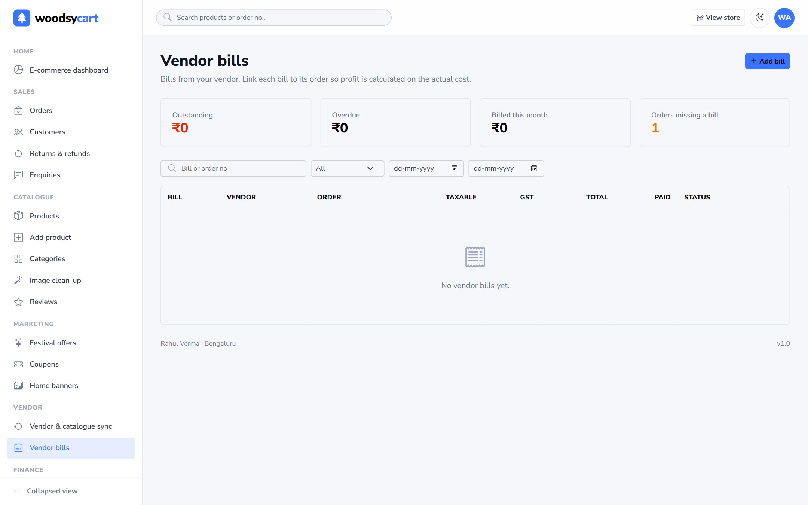

**Summary cards:**

| Card | Meaning |
|---|---|
| **Outstanding** | Total of all bills minus what you've paid |
| **Overdue** | The part of outstanding whose **due date** has passed |
| **Billed this month** | Bills dated this month |
| **Orders missing a bill** | Orders with the vendor or later that have no bill (click to see them) |

**Columns:** **Bill** (number, date, due date), **Vendor**, **Order** (or *General* for bills not tied to one order, e.g. a sample piece), **Taxable**, **GST**, **Total**, **Paid**, **Status** (Unpaid / Partially paid / Paid).

**Actions:** 📎 view the attached bill; **Pay** records a payment (**Amount**, **Paid on**, **Reference / UTR**); ✏ edit; 🗑 delete.

**Add bill:** **Vendor**, **Order ID** (optional; links the bill to an order so its profit becomes *Actual*), **Bill number**, **Bill date**, **Due date**, **Taxable value**, **GST**, **Delivery charges**, **Bill file**, **Notes**.

> **Tip:** the easiest way is **Add vendor bill** on the order page itself: it's linked automatically and pre-filled with the expected amounts.

---

## 20. Finance → Profit & loss

*Menu: Finance → Profit & loss.*

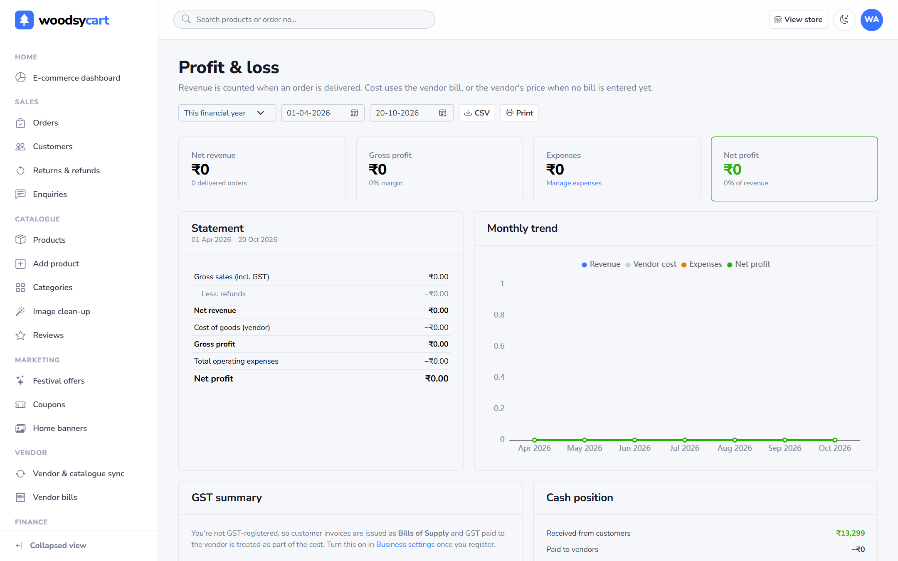

**Period:** **This month / Last month / Last 3 months / This financial year** (April–March) / **Custom** dates. **CSV** downloads the report; **Print** prints it.

> **Important rule:** revenue is counted **when an order is delivered**, not when it's placed. A big order placed today shows in the dashboard's sales straight away, but only in P&L once it's delivered.

### 20.1 Top cards

**Net revenue** (with the number of delivered orders), **Gross profit** (with margin %), **Expenses**, **Net profit** (with margin %).

### 20.2 Statement: every line

| Line | How it's worked out |
|---|---|
| **Gross sales (incl. GST)** | Total of delivered orders in the period |
| *Already after discounts* | Information only: festival-offer savings and coupons already taken off those sales |
| **Less: GST collected** | GST included in those sales (only if GST-registered; you pay it to the government) |
| **Less: refunds** | Refunds **processed** in the period |
| **Net revenue** | Gross sales − GST − refunds |
| **Cost of goods (vendor)** | For each delivered order, its vendor bill if entered, otherwise the vendor price at order time; plus bills not linked to orders. (Before GST if you're GST-registered, including GST if not.) |
| *… is estimated* | How much of the cost has no vendor bill yet. Add bills for exact figures. |
| **Gross profit** | Net revenue − cost of goods |
| *Expense lines* | Your expenses by category |
| **Total operating expenses** | Sum of expenses dated in the period |
| **Net profit** | Gross profit − expenses: **what the business actually earned** |

### 20.3 Monthly trend

A chart of revenue, cost, expenses and net profit per month.

### 20.4 GST summary

- **GST-registered:** **Output GST** (on sales) − **Input GST** (on vendor bills and expenses) = **Net GST payable** to the government.
- **Not registered:** invoices are *Bills of Supply* without tax, and GST paid to the vendor is part of your cost.

### 20.5 Cash position

Actual money movements in the period, which is different from profit: **Received from customers**, **Paid to vendors**, **Expenses paid**, **Net cash flow**. Also, for all time: **Receivable from customers** (confirmed or delivered orders not fully paid) and **Payable to vendors** (unpaid bills).

### 20.6 Profit by order

Every delivered order: **Revenue (ex-GST)**, **Cost** (✱ = estimated, no bill yet), **Profit**, **Margin**. Red rows lost money.

---

## 21. Finance → Customer invoices

*Menu: Finance → Customer invoices.*

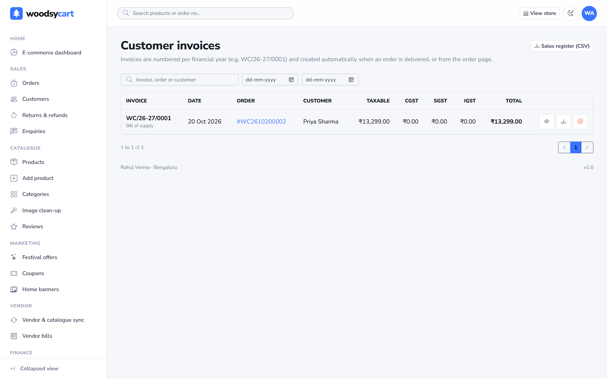

- **Numbering:** `WC/26-27/0001`: your prefix, the **financial year** (April–March), then a running number that restarts each year. Set the prefix in Business settings → Tax & invoice.
- **Tax invoice / Bill of supply:** when you're GST-registered, invoices are *Tax invoices* with GST shown; otherwise they're *Bills of supply* with no tax.
- **CGST + SGST** (half each) when the customer is in Karnataka, your own state; **IGST** when they're in another state.
- **When created:** automatically when an order is marked **Delivered**, or with **Generate invoice** on the order.
- **Actions:** 👁 open the PDF, ⬇ download, ⊗ **cancel** (a cancelled invoice stays in the list, greyed out, for your records; you can then generate a new one from the order).
- **Sales register (CSV):** all invoices for the date range, for your accountant or GST filing.

---

## 22. Finance → Expenses

*Menu: Finance → Expenses.* Running costs that aren't vendor bills.

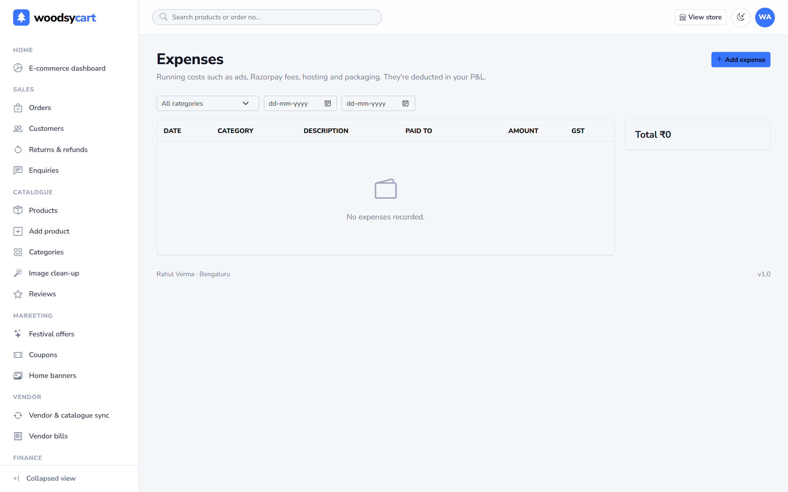

**Categories:** Marketing, Advertising, Packaging, Delivery, Payment gateway fees, Software & hosting, Salary, Rent, Utilities, Legal, Miscellaneous.

**Add expense:** **Date**, **Category**, **Description**, **Amount (ex-GST)**, **GST**, **Paid to**, **Payment mode**, **Reference**, **Receipt** (PDF/photo). The right panel shows the **Total** and the total per category for the selected filter. Expenses are subtracted in Profit & loss.

> **Tip:** record gateway fees, Google/Instagram ads and hosting every month, or your net profit will look higher than it really is.

---

## 23. Settings → Payment integrations

*Menu: Settings → Payment integrations.* How customers pay. There are three tabs.

### 23.1 Checkout methods tab

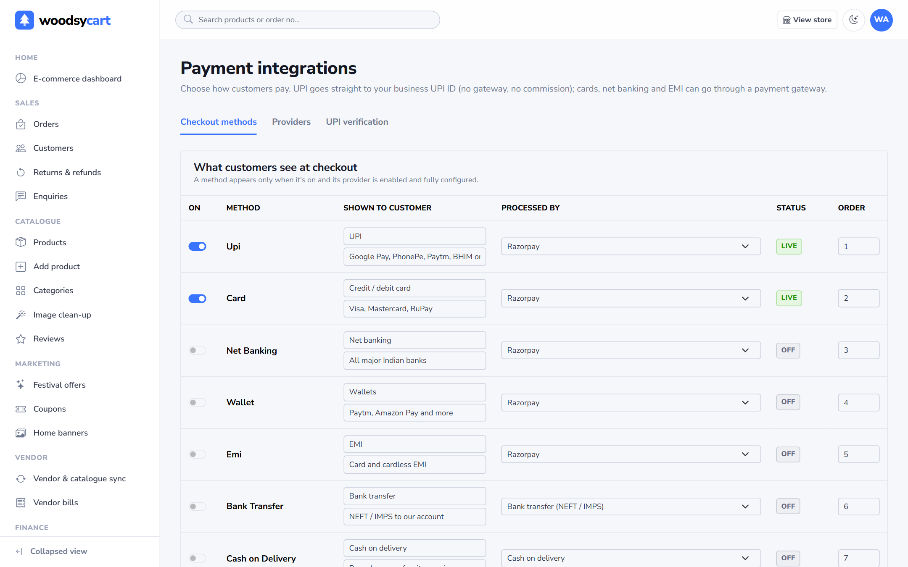

The payment choices customers see at checkout:

| Column | Meaning |
|---|---|
| **On** | Offer this method |
| **Method** | UPI, Card, Net banking, Wallet, EMI, Bank transfer, Cash on delivery |
| **Shown to customer** | The label and short description at checkout |
| **Processed by** | Which provider handles it, e.g. UPI → **Direct UPI (no gateway)**, ₹0 commission |
| **Status** | Whether it will actually appear (the provider must be on and set up) |
| **Order** | Position at checkout |

A method only appears when it's on **and** its provider is enabled and fully configured. Press **Save checkout methods**.

### 23.2 Providers tab

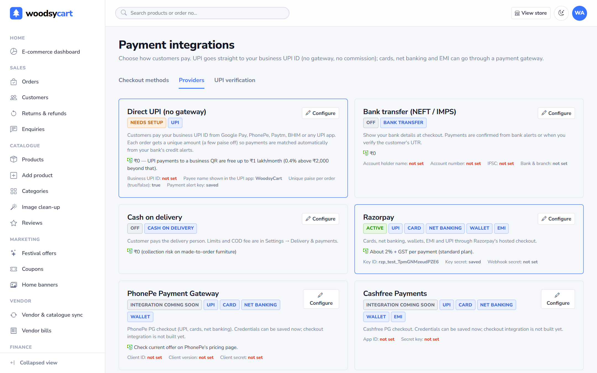

Each provider card shows **Active / Needs setup / Off / Integration coming soon**, the methods it can handle, its fees, and its settings ("saved" for secrets). **Configure** opens its settings:

- **Direct UPI (no gateway):** your business **UPI ID**, **payee name**, the **unique paise amount** switch (see [3.7](#37-the-unique-upi-amount-direct-upi)) and the alert key. Free.
- **Bank transfer (NEFT / IMPS):** account name, number, IFSC, bank.
- **Cash on delivery.**
- **Razorpay:** key id and secret (live or **Test mode**). PhonePe, Cashfree, PayU and Paytm are listed for the future.

Secrets are stored encrypted and never shown again; you only see "saved".

### 23.3 UPI verification tab

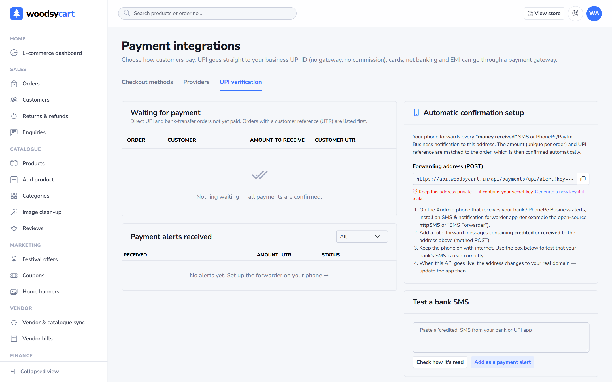

- **Waiting for payment:** Direct UPI and bank-transfer orders not yet paid. Orders where the customer typed their **UTR** come first. Check your bank app, then confirm.
- **Payment alerts received:** "money received" messages forwarded from your phone, and whether each was matched to an order. Unmatched ones can be **matched** to an order by hand or **ignored**.
- **Automatic confirmation setup:** the **Forwarding address** for the SMS/notification forwarder app on your phone, with step-by-step instructions. Keep it private; **Generate a new key** if it leaks.
- **Test a bank SMS:** paste a real "credited" SMS and press **Check how it's read** to confirm the amount and reference are recognised. **Add as a payment alert** is for when your phone was offline when the payment came in.

---

## 24. Settings → Delivery pincodes

*Menu: Settings → Delivery pincodes.* Where you deliver.

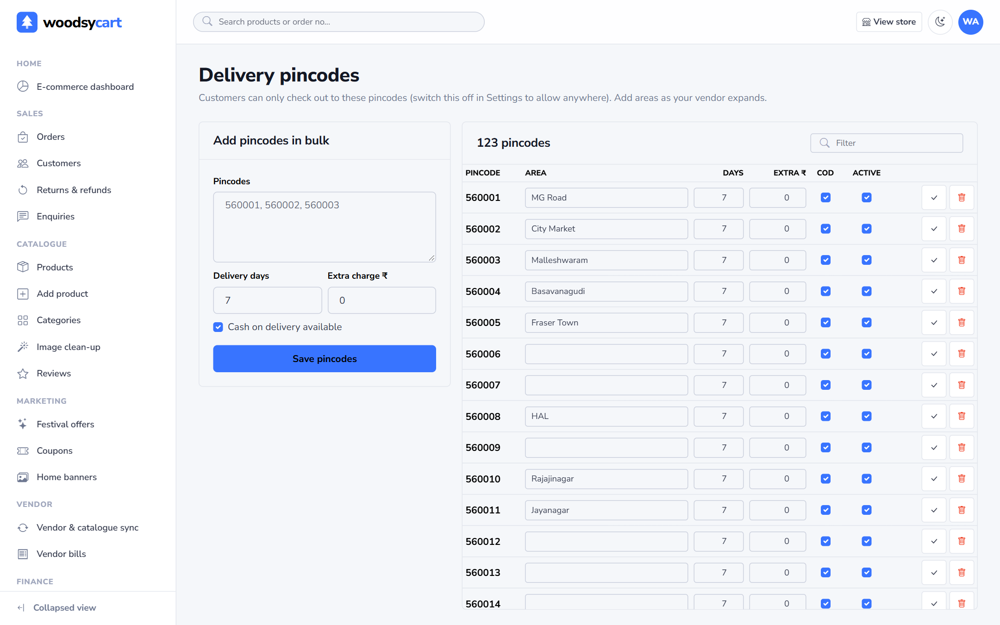

- **Add pincodes in bulk:** paste pincodes (separated by commas or new lines), set **Delivery days**, **Extra charge ₹** (added to the delivery fee) and **Cash on delivery available**, then **Save pincodes**.
- **Table:** edit **Area**, **Days**, **Extra ₹**, **COD** and **Active** for each pincode, then press ✔ to save the row; 🗑 deletes it.
- When **Only deliver to pincodes in the delivery list** is on (Business settings → Checkout), customers with other pincodes can't check out.
- The customer sees *"Delivery in X–Y days to <Area>"* when they check their pincode.

---

## 25. Settings → Business settings

*Menu: Settings → Business settings* (or the profile menu → Settings). Five tabs; press **Save settings** after changes.

### 25.1 Business tab


**Store name**, **Legal name** (on invoices), **Tagline**, address with **State code** (used for GST: 29 = Karnataka), **Phone**, **WhatsApp** (shown to customers), **Email**, **Website**, **Instagram/Facebook URL**, **Logo for invoices**.

### 25.2 Tax & invoice tab

**I'm registered under GST** (see chapters 20–21 for what it changes), **GSTIN**, **PAN**, **Invoice prefix**, **Bank details** and **UPI id** printed on invoices, **Invoice terms & conditions**.

### 25.3 Pricing tab

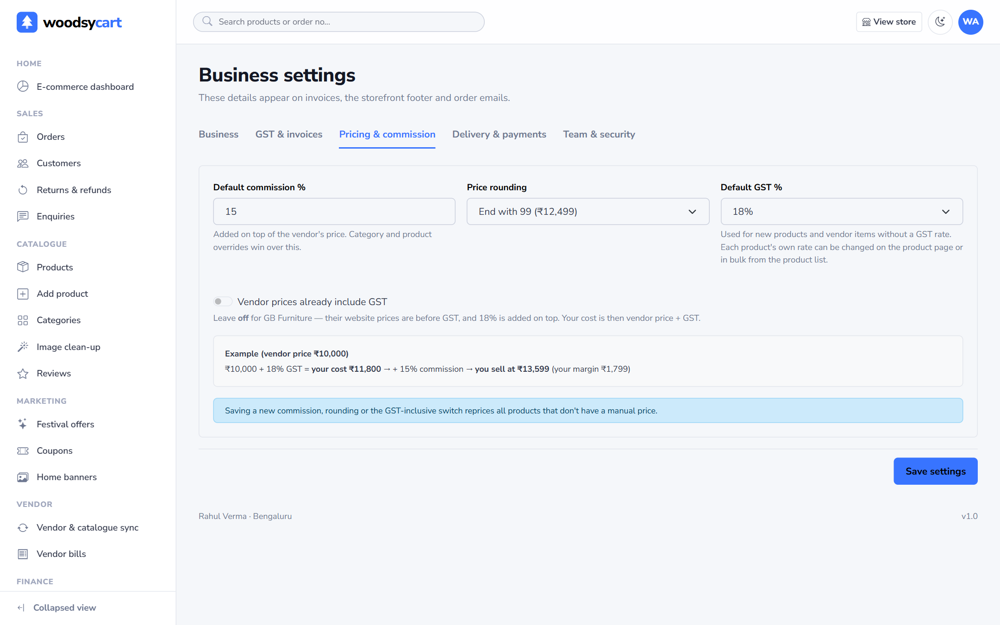

**Default commission %**, **Price rounding**, **Default GST %**, **Vendor prices already include GST** (leave **off** for GB Furniture), and a live **Example** showing the cost, selling price and margin for a ₹10,000 product. **Saving reprices every product** that doesn't have a manual price.

### 25.4 Checkout tab

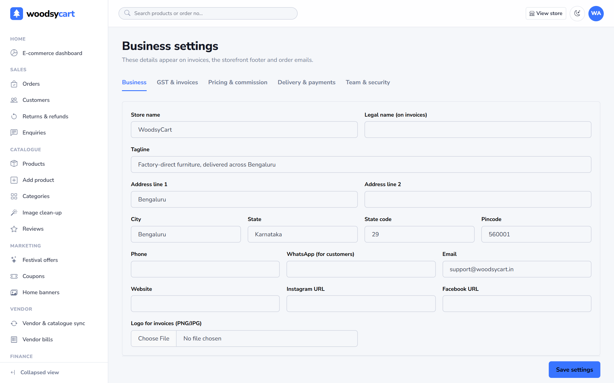

| Setting | Meaning |
|---|---|
| **Delivery fee ₹** | Charged per order |
| **Free delivery above ₹** | Orders at or above this (after coupon) get free delivery. 0 = no threshold |
| **Default delivery days** | Used when a pincode has no own value |
| **Allow cash on delivery** | Turns COD on for the whole store |
| **COD fee ₹** | Extra charge for COD |
| **Max COD order ₹** | Larger orders can't use COD |
| **Only deliver to pincodes in the delivery list** | Restricts checkout to your pincode list |

> **Watch out:** furniture is made to order. A refused COD delivery still costs you the vendor's price. Keep the COD limit low.

### 25.5 Team tab

- **Team:** each member's **Name**, **Email**, **Role** (Admin / Staff), **Last login** and **Status**. **Add member** / ✏ to edit; on an existing member, **Reset password (optional)** sets a new password.
- **Change my password:** your current password and a new one (8+ characters).

---

## 26. Daily, weekly and monthly routines

### Every morning (15 minutes)

1. **Dashboard → Needs your attention**: anything new?
2. **Orders → Needs action**:
   - **Pending:** check the payment arrived (Payment integrations → **UPI verification**), then **Mark confirmed**.
   - **Confirmed:** **WhatsApp message** to the vendor → **Mark placed with vendor**.
3. Ask the vendor about orders **With vendor**. If something is late, **Change** the delivery date with a reason.
4. **Dispatched** orders that arrived: **Mark delivered** (and tick "collected on delivery" for COD).
5. **Enquiries**: reply to new ones on WhatsApp.

### Every week

1. **Orders → Missing vendor bill**: add the vendor's bills.
2. **Vendor bills**: pay what's due and record it with **Pay**.
3. **Products → Vendor price changed**: check the new prices, then **Accept price change**.
4. **Reviews**: approve the genuine ones.
5. **Image clean-up → To review**: approve or restore.

### Every month

1. **Expenses**: add ads, gateway fees, hosting, packaging.
2. **Profit & loss → Last month**: check net profit; download the **CSV** for your records.
3. **Customer invoices → Sales register (CSV)** for your accountant / GST filing.
4. Plan the next **Festival offer**.

---

## 27. Status reference

### Order status

| Status | Meaning |
|---|---|
| **Pending** | Placed; waiting for payment or your confirmation |
| **Confirmed** | Payment received / approved; not yet sent to the vendor |
| **Placed with vendor** | The vendor is making / preparing it |
| **Dispatched** | The vendor sent it |
| **Out for delivery** | On the last leg (optional step) |
| **Delivered** | Received by the customer; invoice created; counts in P&L |
| **Cancelled** | Cancelled before dispatch |
| **Returned** | Returned after delivery and refunded |

### Payment status

| Status | Meaning |
|---|---|
| **Pending** | Nothing received yet |
| **Partially paid** | Part of the total received |
| **Paid** | Fully received (differences under ₹1 count as paid) |
| **Failed** | An online payment failed |
| **Refunded** | Fully refunded |
| **Partially refunded** | Part refunded |

### Other statuses

| Where | Statuses |
|---|---|
| **Purchase order** | Draft → Sent → Accepted → Dispatched → Delivered (or Cancelled) |
| **Vendor bill** | Unpaid → Partially paid → Paid |
| **Refund** | Requested → Approved → Processed (or Rejected) |
| **Enquiry** | New → In progress → Closed |
| **Festival offer** | Scheduled → Live now → Ended (or Off) |
| **Image clean-up** | Not processed, Clean, Cleaned, To review, Failed, Restored, Approved |
| **Product** | Published / Draft; In stock / Out of stock; Featured |

---

## 28. Questions and troubleshooting

**A customer paid by UPI but the order is still Pending.**
Open **Payment integrations → UPI verification**. If the payment alert arrived but wasn't matched, match it to the order. If no alert came (phone offline), check your bank app and use **Record payment** on the order with the UTR.

**The customer can't find their order on "Track order".**
They must enter the order number and the mobile number used at checkout (any format: +91, spaces…). Check the phone number on the order page.

**A product shows the wrong price.**
Check the product's **Pricing** tab: the vendor price, GST %, commission override and whether **manual price** is on. Category commission and **Business settings → Pricing** also affect it.

**The vendor's price changed. Do I need to do anything?**
Your selling price is updated automatically. Just review it under **Products → Vendor price changed**, then **Accept price change**.

**Why is my P&L lower than the dashboard?**
The dashboard counts orders when they're **placed**; P&L counts them when **delivered**, after GST, refunds, vendor costs and expenses.

**Why does an order's profit say "Estimated"?**
No vendor bill is linked yet. Add it from the order page.

**A photo still shows the vendor's name.**
Open **Image clean-up**, find the photo and press **Re-run**, or replace the photo on the product.

**I deleted something by mistake.**
Deleted products are hidden, not erased. Ask your developer to restore them. Orders, invoices and payments can't be deleted from the app.

**Someone left the team.**
**Business settings → Team** → edit them → switch **Active** off.

---

## 29. Glossary

| Term | Meaning |
|---|---|
| **AOV** | Average order value = total spent ÷ number of orders |
| **Bill of supply** | Invoice without GST (when you're not GST-registered) |
| **CGST / SGST / IGST** | GST split: central + state (same state), or integrated (other state) |
| **COD** | Cash on delivery |
| **Commission** | Your mark-up % on top of your cost |
| **Drop-shipping** | You sell; the vendor makes and delivers directly to the customer |
| **GSTIN** | GST registration number |
| **HSN code** | Product tax classification printed on invoices (furniture: 9403) |
| **Margin** | Selling price − your cost |
| **MRP** | Maximum retail price (shown struck through) |
| **PO** | Purchase order: your order to the vendor |
| **Slug** | The readable part of a web address, e.g. `queen-size-bed` |
| **Sync** | Copying the vendor's catalogue into your store |
| **UTR** | Unique transaction reference of a UPI/bank payment (12 digits) |
| **Variant** | One sellable combination of options, e.g. 6×5 ft in Walnut |
| **Vendor** | The supplier who makes the furniture (GB Furniture) |

---

*WoodsyCart Admin Guide · keep this document with your business records. If a screen changes after an update, the chapter for that screen will be updated.*
